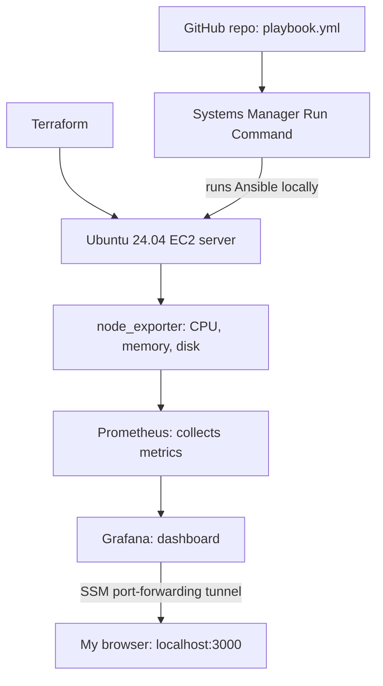

# Linux Server Monitoring with Prometheus & Grafana

An Ubuntu server on AWS, built with Terraform and configured by an Ansible playbook that installs Prometheus, node_exporter, and Grafana — viewed through a Systems Manager tunnel with **no open inbound ports**.


## Architecture



## How it works

1. **Terraform** builds the VPC, a security group with no inbound rules, an IAM role for Systems Manager, and an Ubuntu 24.04 EC2 instance with an encrypted disk and IMDSv2.
2. **Systems Manager** downloads `playbook.yml` from this repo and runs **Ansible** on the server — no SSH.
3. **Ansible** installs and starts:
   - **node_exporter** — reads the server's CPU, memory, disk, and network stats
   - **Prometheus** — collects and stores those metrics
   - **Grafana** — automatically connected to Prometheus
4. I open Grafana through an **SSM port-forwarding tunnel** to `localhost:3000`.

## Design decisions

- **No inbound ports.** No SSH, no public Grafana. Everything goes through Systems Manager, so nothing is exposed to the internet.
- **Configuration as code.** The whole monitoring stack is defined in one Ansible playbook.
- **Idempotent.** Running the playbook a second time reports `changed=0`, because everything is already in the right state.
- **Least privilege.** The server's IAM role only has Systems Manager access.
- **Grafana is provisioned automatically.** The Prometheus data source is written by Ansible, so no clicking is needed after install.

## Challenge I solved

**AWS's Ansible document failed on Ubuntu 24.04.** `AWS-ApplyAnsiblePlaybooks` tries to install Ansible with `pip`, but Ubuntu 24.04 blocks system-wide pip installs (PEP 668, "externally-managed-environment"). I installed Ansible from Ubuntu's apt repository with `AWS-RunShellScript` instead, then ran the playbook with the document's dependency install turned off.

## Run it yourself

```bash
cd terraform
terraform init
terraform apply
```

Then in Systems Manager:
1. `AWS-RunShellScript`: `apt-get update && apt-get install -y ansible`
2. `AWS-ApplyAnsiblePlaybooks` with Source Type `GitHub`, this repo, `playbook.yml`, Install Dependencies `False`
3. Open the tunnel:
```bash
aws ssm start-session --target <instance-id> --document-name AWS-StartPortForwardingSession --parameters portNumber=3000,localPortNumber=3000
```
4. Browse to `http://localhost:3000` and import dashboard **1860** (Node Exporter Full).

## Tech stack

AWS (EC2, VPC, IAM, Systems Manager) · Terraform · Ansible · Prometheus · node_exporter · Grafana · Ubuntu Linux
